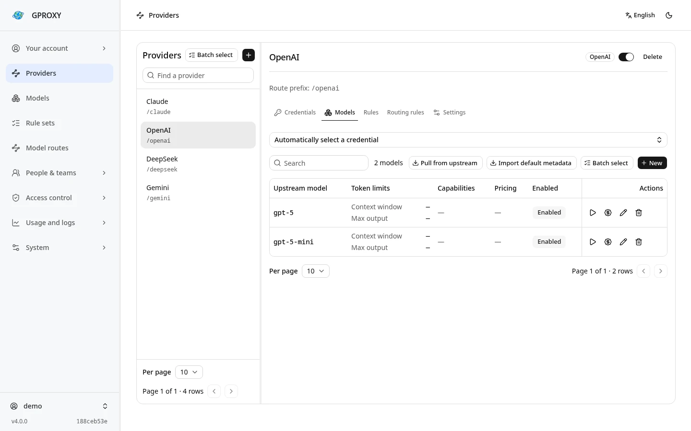

# GPROXY

[English](README.md) · [简体中文](README.zh-CN.md) · [Русский](README.ru.md)

[](https://github.com/LeenHawk/gproxy/releases/latest)
[](https://github.com/LeenHawk/gproxy/actions/workflows/ci.yml)
[](LICENSE)
[](https://app.fossa.com/projects/custom%2B37316%2Fgithub.com%2FLeenHawk%2Fgproxy?ref=badge_shield)

<a href="https://deploy.workers.cloudflare.com/?url=https%3A%2F%2Fgithub.com%2FLeenHawk%2Fgproxy%2Ftree%2Fdev%2Fdeploy%2Fcloudflare-button"></a>
<a href="https://app.netlify.com/start/deploy?repository=https%3A%2F%2Fgithub.com%2FLeenHawk%2Fgproxy&branch=dev&create_from_path=deploy%2Fserverless"></a>
<a href="https://vercel.com/new/clone?repository-url=https%3A%2F%2Fgithub.com%2FLeenHawk%2Fgproxy%2Ftree%2Fdev%2Fdeploy%2Fserverless&project-name=gproxy&repository-name=gproxy&env=GPROXY_ADMIN_PASSWORD%2CGPROXY_MASTER_KEY&products=%5B%7B%22type%22%3A%22integration%22%2C%22group%22%3A%22postgres%22%2C%22protocol%22%3A%22storage%22%7D%5D"></a>
<a href="https://render.com/deploy?repo=https%3A%2F%2Fgithub.com%2FLeenHawk%2Fgproxy%2Ftree%2Fdev"></a>
<a href="https://heroku.com/deploy?template=https%3A%2F%2Fgithub.com%2FLeenHawk%2Fgproxy%2Ftree%2Fdev"></a>

GPROXY is a self-hosted gateway for LLM APIs, written in Rust. You give it your
upstream accounts (API keys, OAuth logins such as Codex or Claude Code, or
browser cookies) and your clients get one base URL, one GPROXY API key and
model names that you define.

For each request GPROXY resolves the model name to a provider, picks a working
credential, converts between the OpenAI, Claude and Gemini request formats if
the client and the upstream speak different ones, and records the tokens and
cost. If a credential or provider fails, it retries on the next one. Users,
API keys, permissions, rate limits and spending budgets are managed in a web
console or through the management API.

GPROXY does not run models. Inference is done by the upstream service.

The full manual is at **<https://gproxy.leenhawk.com/>**.



## Features

- Client-facing APIs: OpenAI Chat Completions and Responses, Claude Messages
  and Gemini GenerateContent, streaming included, with conversion in either
  direction. Embeddings, images, audio, video, files and Realtime are available
  on the channels whose upstream offers them.
- Built-in channels for OpenAI, Claude API, Claude Code, Claude Web, Codex,
  Gemini CLI, Antigravity, Google AI Studio, Vertex AI, AWS Bedrock, Azure,
  GitHub Copilot CLI, OpenRouter, DeepSeek, GLM, Kimi, MiniMax, DashScope,
  Volcengine, xAI, Kiro and more; the [provider
  guide](https://gproxy.leenhawk.com/guides/providers) has the full list.
  Anything that speaks one of the three protocols can be added with the
  `custom` channel.
- Model routes: clients ask for `fast` or `coding`; you decide which providers
  and upstream models serve it, with weights and fallback tiers.
- Credential pools with OAuth refresh, health tracking, upstream quota
  queries and failover.
- Rewrite rules for system prompts, prompt-cache breakpoints, JSON fields,
  regular expressions and headers, per provider.
- Users, organizations, teams, scoped administrators, per-key permissions,
  rate limits and budgets. Usage, request logs and an audit log.
- Runs as a native server, a desktop or mobile app, a container, or a
  Cloudflare Worker / Netlify / Vercel function. Rust programs can embed it
  through `gproxy-sdk`.

## Installing

On Linux and macOS:

```sh
curl -fsSL https://gproxy.leenhawk.com/install.sh | sh
```

On Windows (PowerShell):

```powershell
irm https://gproxy.leenhawk.com/install.ps1 | iex
```

The script downloads the latest stable CLI, asks a few questions (data
directory, port, administrator password) and can register a background
service. Run it with `--help` to see the options, for example `--edition
headless` for a build without the web console.

You can also download a package by hand from
[Releases](https://github.com/LeenHawk/gproxy/releases/latest). Each release
contains:

- `gproxy-*`: the CLI with the web console built in;
- `gproxy-headless-*`: the CLI without the console, for CI and small servers;
- `gproxy-tauri-*`: the desktop and mobile application.

GPROXY Desktop, CLI and Headless are also on the Microsoft Store
([Desktop](https://apps.microsoft.com/detail/9P2FJRB9RS4Z),
[CLI](https://apps.microsoft.com/detail/9NBMH3S5K0L9),
[Headless](https://apps.microsoft.com/detail/9ND7FQQMV566)), and the Android
app is on [F-Droid](https://f-droid.org/packages/com.leenhawk.gproxy.desktop/).
macOS builds are not notarized. The [download
page](https://gproxy.leenhawk.com/download) lists every platform and its
requirements.

Stable releases are tagged `vX.Y.Z`. The `staging` and `nightly` releases are
the beta and development channels.

## Getting started

Start the server with a data directory:

```sh
./gproxy serve --data-dir ./data --port 8787
```

The first time it runs in a terminal it asks a few setup questions. Without a
terminal it creates an administrator account and prints the password and a
gateway API key; save both. By default it listens on 127.0.0.1 and keeps its
SQLite database in `./data/gproxy.db`.

Set `GPROXY_MASTER_KEY` before you add any upstream credentials. Without it,
upstream secrets are stored unencrypted. Keep the key and the data directory
together when you move or upgrade the instance; see
[Configuration](https://gproxy.leenhawk.com/reference/configuration).

Then open <http://127.0.0.1:8787/console/> and:

1. Under **Providers**, add a provider (for example `openai-main` on the
   `openai` channel) and its API key, and test the credential.
2. Under **Model routes**, create a route named `fast` with that provider and
   the model you tested as its member.

Now any OpenAI-compatible client can use it with the gateway API key:

```sh
export GPROXY_KEY='your-gproxy-api-key'
curl http://127.0.0.1:8787/v1/chat/completions \
  -H "Authorization: Bearer $GPROXY_KEY" \
  -H 'Content-Type: application/json' \
  -d '{"model":"fast","messages":[{"role":"user","content":"Hello"}]}'
```

The same route answers Claude (`/v1/messages`) and Gemini
(`/v1beta/models/fast:generateContent`) requests. The
[tutorial](https://gproxy.leenhawk.com/getting-started/quick-start) goes
through this step by step, and [CLI
clients](https://gproxy.leenhawk.com/guides/cli-clients) shows how to point
Codex CLI and Claude Code at the gateway.

The desktop and mobile app runs the same steps as a setup wizard and has the
console built in.

## Hosted deployment

The deploy buttons at the top of this page use the templates described here. The
Cloudflare, Netlify and Vercel ones deploy a prebuilt bundle of the latest
stable release; nothing is compiled. Cloudflare uses D1 or
libSQL/Turso, the other two use PostgreSQL. Render and Heroku run the native
binary in a small container with PostgreSQL.

You will be asked for an administrator password and a master key. Read
[Hosted deployments](https://gproxy.leenhawk.com/deployment/edge) and
[Docker, Render and Heroku](https://gproxy.leenhawk.com/deployment/containers)
first; they cover database choice, plan costs and what does not work on
serverless platforms (WebSocket support, for example).

## Upgrading from v3

Stop v3 and back up its database, master key and startup configuration. Then
start v4 with the same configuration. SQLite, PostgreSQL, MySQL and D1
databases are migrated on first start; accounts, passwords, API keys and
usage history are kept, and anything that could not be mapped is listed in the
migration report. Do not run v3 and v4 against the same database at the same
time. Details are in [Migrating v3 to
v4](https://gproxy.leenhawk.com/deployment/v3-to-v4).

## Performance

Measured with the [v4.0.0 Linux x86_64
release](https://github.com/LeenHawk/gproxy/releases/tag/v4.0.0) on a Ryzen 7
8745H (8 cores, 16 threads), SQLite on NVMe, with the load generator
(`oha 1.16.0`), the gateway and a mock upstream on the same machine. Requests
were non-streaming Chat Completions passing through authentication, routing,
usage extraction, pricing and persistence. The mock returned 25 input and 18
output tokens with no delay. Body logging was off; usage recording and cost
settlement were on. Each figure is the median of three 10-second runs after a
2-second warm-up.

| Request logs | Connections | Requests/s | p50 | p99 |
| --- | ---: | ---: | ---: | ---: |
| Off | 1 | 2,882 | 0.34 ms | 0.50 ms |
| Off | 32 | 28,303 | 0.76 ms | 2.71 ms |
| Off | 64 | 27,263 | 1.47 ms | 41.91 ms |
| Upstream and downstream metadata | 64 | 7,765 | 2.81 ms | 45.16 ms |

With one connection the gateway adds about 0.30 ms to the median latency of
calling the mock directly. All 1,989,395 requests returned 200, and the stored
usage rows matched the request count with correct tokens and cost. Throughput
stops growing at around 64 connections, where p99 rises to about 42 ms. These
numbers are for short responses, same-protocol forwarding and local SQLite;
measure your own workload if it involves long streams, protocol conversion, a
remote database or real upstreams.

## Building from source

You need stable Rust, Go and Clang, and for the console Node.js 22.12 or later
and pnpm. The console has to be built before the binary, otherwise the binary
has no console to serve:

```sh
pnpm --dir console install --frozen-lockfile
pnpm --dir console build
cargo run -p gproxy -- serve
```

[Building from source](https://gproxy.leenhawk.com/development/building)
covers the headless build, the desktop app, the Workers bundle and the checks
CI runs. Contributors should also read
[CONTRIBUTING.md](CONTRIBUTING.md) and
[Architecture](https://gproxy.leenhawk.com/development/architecture); to add an
upstream, see [Adding a
channel](https://gproxy.leenhawk.com/development/adding-a-channel).

## Reporting bugs

Use [Issues](https://github.com/LeenHawk/gproxy/issues) for bugs and
[Discussions](https://github.com/LeenHawk/gproxy/discussions) for questions.
For anything you would rather not post publicly, email
[leenhawk@leenhawk.com](mailto:leenhawk@leenhawk.com). Report security
problems privately as described in [SECURITY.md](SECURITY.md).

## License

GPROXY is licensed under the GNU Affero General Public License, version 3 or
later; see [LICENSE](LICENSE). The library crates `gproxy-protocol`,
`gproxy-protocol-macros`, `gproxy-client`, `gproxy-client-sdk`,
`gproxy-cache`, `gproxy-file`, `gproxy-seaorm`, `gproxy-store` and
`gproxy-tokenizer` are MIT-licensed; each has its own license file.

## Acknowledgements

Development tools are provided by the [JetBrains open source
program](https://jb.gg/OpenSource). If you find GPROXY useful, you can
[sponsor](https://github.com/sponsors/LeenHawk) its development.

[](https://www.star-history.com/#LeenHawk/gproxy&Date)
