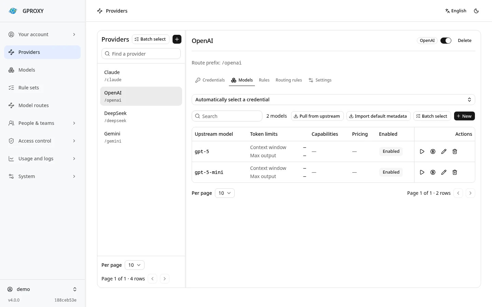
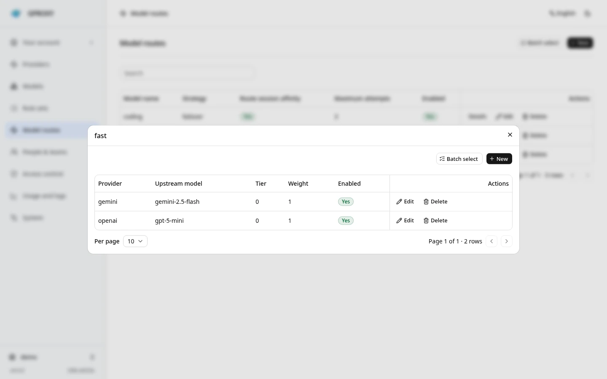
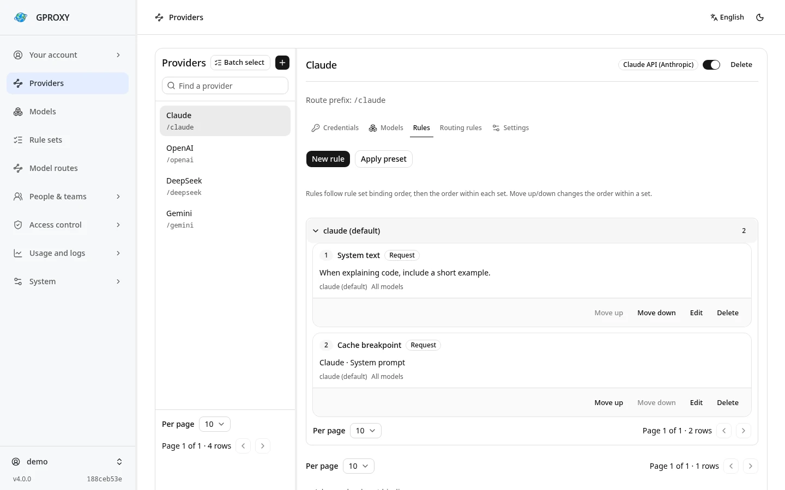

<div align="center">

# GPROXY

**Одна конечная точка API для ваших сервисов LLM.**

[English](README.md) · [简体中文](README.zh-CN.md) · [Русский](README.ru.md)

[](https://github.com/LeenHawk/gproxy/releases/latest)
[](https://github.com/LeenHawk/gproxy/actions/workflows/ci.yml)
[](LICENSE)
[](https://github.com/LeenHawk/gproxy/stargazers)

[Документация](https://gproxy.leenhawk.com/ru/) · [Загрузки](https://github.com/LeenHawk/gproxy/releases) · [Обсуждения](https://github.com/LeenHawk/gproxy/discussions) · [Поддержать](https://github.com/sponsors/LeenHawk)

[](https://gproxy.leenhawk.com/ru/)

[](https://deploy.workers.cloudflare.com/?url=https%3A%2F%2Fgithub.com%2FLeenHawk%2Fgproxy%2Ftree%2Fdev%2Fdeploy%2Fcloudflare-button)
[](https://app.netlify.com/start/deploy?repository=https%3A%2F%2Fgithub.com%2FLeenHawk%2Fgproxy&branch=dev&create_from_path=deploy%2Fserverless)
[](https://vercel.com/new/clone?repository-url=https%3A%2F%2Fgithub.com%2FLeenHawk%2Fgproxy%2Ftree%2Fdev%2Fdeploy%2Fserverless&project-name=gproxy&repository-name=gproxy&env=GPROXY_ADMIN_PASSWORD%2CGPROXY_MASTER_KEY&products=%5B%7B%22type%22%3A%22integration%22%2C%22group%22%3A%22postgres%22%2C%22protocol%22%3A%22storage%22%7D%5D)

</div>

GPROXY — это автономный шлюз LLM API, написанный на Rust. Добавляйте учётные записи своих провайдеров, настраивайте маршруты моделей в консоли и вызывайте различные службы через одну и ту же конечную точку и ключ API шлюза. Изменения провайдеров, обновления учётных данных, использование и расходы управляются в одном месте.

Версия 4 работает как настольное или мобильное приложение с мастером настройки, службой CLI, контейнером или в Cloudflare, Netlify и Vercel. Используйте [последнюю стабильную версию](https://github.com/LeenHawk/gproxy/releases/latest) для регулярных развертываний; снимки разработки доступны под [nightly](https://github.com/LeenHawk/gproxy/releases/tag/nightly).

## Функции

<table>
<tr>
<td width="50%" valign="top">
<h3>Протоколы и клиенты</h3>
<p>Принимает OpenAI Chat Completions, Responses, Claude Messages и Gemini GenerateContent с преобразованием протокола и потоковой передачей. Руководства для клиентов охватывают Codex CLI, Claude Code и другие инструменты.</p>
</td>
<td width="50%" valign="top">
<h3>Пулы учётных данных</h3>
<p>Используйте ключи API, OAuth или файлы cookie, поддерживаемые каждым каналом. Управляйте обновлением, работоспособностью и квотами с помощью настраиваемого переключения при сбое с использованием других учётных данных или провайдеров аутентификации.</p>
</td>
</tr>
<tr>
<td valign="top">
<h3>Маршруты моделей</h3>
<p>Дайте клиентам фиксированное имя модели, например <code>fast</code>. Меняйте провайдеров, модели провайдеров, веса и резервные уровни в шлюзе, не редактируя каждого клиента.</p>
</td>
<td valign="top">
<h3>Перезапись запросов</h3>
<p>Настройте системный текст, точки кэширования, изменения JSON, регулярные выражения и правила заголовков для каждого провайдера для поддержки разных клиентов.</p>
</td>
</tr>
<tr>
<td valign="top">
<h3>Доступ, использование и стоимость</h3>
<p>Управляйте пользователями, организациями, командами, ключами API, разрешениями и бюджетами расходов. Просматривайте журналы использования, запросов провайдеров и клиентов, а также записи аудита в консоли.</p>
</td>
<td valign="top">
<h3>Локальные и серверные развертывания</h3>
<p>Используйте приложение на личном устройстве, запустите CLI или контейнер на сервере или разверните его в Cloudflare, Netlify и Vercel. Проекты Rust могут встраивать шлюз через SDK.</p>
</td>
</tr>
</table>

Встроенные каналы включают OpenAI, Claude API/Code/Web, Codex, Gemini CLI, Google AI Studio, Copilot, DeepSeek, GLM, MiniMax, Kimi, OpenRouter, AWS Bedrock, Azure, Vertex и xAI. Другие службы, поддерживающие протоколы OpenAI, Claude или Gemini, могут использовать канал `custom`.

Поддержка изображений, аудио, файлов, WebSocket/Realtime и других операций зависит от канала и провайдера. См. [Провайдеры и учётные данные](https://gproxy.leenhawk.com/ru/guides/providers/) и [руководства для клиентов](https://gproxy.leenhawk.com/ru/guides/cli-clients/).

## Консоль

Снимки экрана консоли v4 с использованием отдельного демонстрационного экземпляра с примерами данных.

**Провайдеры и модели**. Управляйте учётными записями провайдеров и каталогами моделей в одном месте.



<details>
<summary>Просмотр моделей маршрутов и правил запроса</summary>

**Маршруты модели** — настройте провайдеров, веса и резервные уровни для фиксированного имени модели.



**Правила запроса** — настройка системного текста и точек кэширования для провайдера.



</details>

## Быстрый старт

### На компьютере или телефоне

1. Загрузите **Приложение** (`gproxy-tauri-*`) для своей платформы с сайта [Релизы](https://github.com/LeenHawk/gproxy/releases/latest).
2. Откройте его и следуйте инструкциям мастера, чтобы настроить экземпляр, учётную запись администратора и дополнительный импорт конфигурации.
3. Сохраните адрес сервиса и ключ API шлюза. Откройте консоль и добавьте провайдера и учётные данные провайдера.
4. Проверьте учётные данные, создайте маршрут модели с именем `fast` и добавьте рабочую модель в качестве участника.

Приложение использует консоль внутри приложения; его порт HTTP обслуживает вызовы шлюза API.

### На сервере

Загрузите **CLI** (`gproxy-*`), распакуйте его и запустите:

```sh
chmod +x ./gproxy
./gproxy serve --data-dir ./data --port 8787
```

В Windows используйте `gproxy.exe`. Сохраните пароль администратора и ключ API, напечатанные при первом запуске, затем откройте **http://127.0.0.1:8787/console/**. Добавьте провайдера, проверьте его учётные данные и создайте маршрут модели, как указано выше.

CLI по умолчанию прослушивает локальный хост, а SQLite — `./data/gproxy.db`. Настройте и сохраните `GPROXY_MASTER_KEY` перед добавлением учётных данных; без него секреты провайдера хранятся в незашифрованном виде. Сохраняйте каталог данных и мастер-ключ при обновлении. Настройте адрес прослушивания и HTTPS для удаленного доступа. См. [ссылка на конфигурацию](https://gproxy.leenhawk.com/ru/reference/configuration/).

### Отправить запрос

Замените ключ ниже ключом вашего шлюза API. `fast` — это маршрут, созданный выше:

```sh
export GPROXY_KEY='your-gproxy-api-key'
curl -sS http://127.0.0.1:8787/v1/chat/completions \
  -H "Authorization: Bearer $GPROXY_KEY" \
  -H 'Content-Type: application/json' \
  -d '{"model":"fast","messages":[{"role":"user","content":"Hello"}],"stream":true}'
```

### Хостинговые развертывания

В шаблонах Cloudflare, Netlify и Vercel используются готовые пакеты **последней стабильной версии** без компиляции Rust. Cloudflare поддерживает D1 или libSQL/Turso; два других используют PostgreSQL. Настройте базу данных, пароль администратора и мастер-ключ, затем выполните развертывание и войдите в систему `/console/`.

См. [руководство по размещению на хостинге](https://gproxy.leenhawk.com/ru/deployment/edge/), чтобы узнать о кнопках развертывания, платформе или внешних базах данных, а также о таких различиях, как поддержка WebSocket.

Эти три шаблона упаковывают **последнюю стабильную версию** исполняемого файла PostgreSQL в легкий контейнер. Перед развертыванием ознакомьтесь с планами платных услуг и баз данных.

<table>
<tr>
<td width="33%" valign="top">
<h3>Оказывать</h3>
<p>Стартовый сервис + Базовый PostgreSQL. Подключение к базе данных и секреты настраиваются автоматически.</p>
<p><a href="https://render.com/deploy?repo=https%3A%2F%2Fgithub.com%2FLeenHawk%2Fgproxy%2Ftree%2Fdev"><strong>Развертывание для рендеринга →</strong></a></p>
</td>
<td width="33%" valign="top">
<h3>Хероку</h3>
<p>Базовый динамометр + Essential PostgreSQL. Возьмите с собой ключ шифрования; база данных создана для вас.</p>
<p><a href="https://heroku.com/deploy?template=https%3A%2F%2Fgithub.com%2FLeenHawk%2Fgproxy%2Ftree%2Fdev"><strong>Развертывание в Heroku →</strong></a></p>
</td>
<td width="33%" valign="top">
<h3>Северный фланг</h3>
<p>Импортируйте шаблон, чтобы создать проект, базу данных PostgreSQL и службу. Ссылка для общего доступа пока недоступна.</p>
<p><a href="https://gproxy.leenhawk.com/ru/deployment/containers/#northflank"><strong>Импортировать шаблон →</strong></a></p>
</td>
</tr>
</table>

[Setup and operating instructions](https://gproxy.leenhawk.com/ru/deployment/containers/)

### Другие варианты развертывания

| Вариант | Вариант использования | Путеводитель |
| --- | --- | --- |
| Приложение | Настольный или мобильный телефон, управление в приложении | [Download & install](https://gproxy.leenhawk.com/ru/download/) |
| CLI / контейнер | Постоянный сервер с консолью браузера | [Download & install](https://gproxy.leenhawk.com/ru/download/) |
| Облачная вспышка / Netlify / Vercel | Хостинговый сервис без собственного сервера | [Deployment guide](https://gproxy.leenhawk.com/ru/deployment/edge/) |
| Северный фланг / Рендер / Хероку | Собственный контейнер с управляемым PostgreSQL | [Deployment guide](https://gproxy.leenhawk.com/ru/deployment/containers/) |
| Rust SDK | Встроить в свою программу | [gproxy-sdk](crates/gproxy-sdk/README.md) |

В Windows обе версии доступны в Microsoft Store:

| GPROXY Рабочий стол | GPROXY CLI |
| :---: | :---: |
| <a href="https://apps.microsoft.com/detail/9P2FJRB9RS4Z?mode=direct"></a> | <a href="https://apps.microsoft.com/detail/9NBMH3S5K0L9?mode=direct"></a> |

Вложения выпуска MSIX представляют собой пакеты отправки в Магазин; используйте ZIP для прямой установки. Приложения macOS не заверяются нотариально. HarmonyOS HAP проверен на эмуляторе и требует вашей собственной подписи. Требования к платформе см. в руководстве по установке.

## Производительность

Конфигурация загружается в снимки в памяти, а исходящие клиенты повторно используются конфигурацией подключения. Захват журнала можно отключить с отдельными настройками для регистрации тела.

В этих измерениях используется официальный **[Версия 4.0.0 Linux x86_64](https://github.com/LeenHawk/gproxy/releases/tag/v4.0.0)** на Ryzen 7 8745H (8 ядер, 16 потоков) с SQLite на NVMe. Генератор нагрузки, шлюз и фиктивный провайдер используют одну машину. Запросы на завершение чата без потоковой передачи проходят проверку подлинности, маршрутизацию модели, извлечение данных об использовании, определение цен и сохранение. Макет сообщает о 25 входных токенах и 18 выходных токенах без искусственной задержки.

Каждый раунд прогревает каждую конфигурацию регистрации в течение 2 секунд, затем измеряет количество каждого соединения в течение 10 секунд с помощью `oha 1.16.0`. Есть три раунда. Каждый показатель ниже представляет собой медиану этих трех прогонов. Регистрация тела отключена; запись использования и расчет затрат включены в обеих конфигурациях журналирования.

| Запросить журналы | Соединения | Запросов/ов | p50 | p99 |
| --- | ---: | ---: | ---: | ---: |
| Выключенный | 1 | 2,882 | 0,34 мс | 0,50 мс |
| Выключенный | 32 | 28,303 | 0,76 мс | 2,71 мс |
| Выключенный | 64 | 27,263 | 1,47 мс | 41,91 мс |
| метаданные провайдера и клиента | 64 | 7,765 | 2,81 мс | 45,16 мс |

При одном подключении шлюз увеличивает среднюю задержку примерно на **0,30 мс** по сравнению с прямым вызовом макета. Все **1 989 395** измеренных запросов вернули HTTP 200. После завершения записи постоянное количество использований соответствовало количеству запросов, и каждая строка проходила проверку токена и стоимости. Ввод и вывод были оценены в 1 доллар за миллион токенов, что привело к зарегистрированной стоимости 0,000043 доллара за запрос.

При 64 соединениях пропускная способность перестает увеличиваться, а p99 возрастает примерно до 42 мс или 45 мс при регистрации метаданных. Этот тест охватывает короткие ответы, пересылку по тому же протоколу и локальный SQLite. Длинные потоки, преобразование протоколов, удаленные базы данных и реальные провайдеры требуют измерений с предполагаемой рабочей нагрузкой.

## Обновление с версии 3

Остановите версию 3, создайте резервную копию базы данных, мастер-ключа и конфигурации запуска, затем запустите версию 4 с той же конфигурацией. Поддерживаемые базы данных SQLite, PostgreSQL, MySQL и D1 v3 автоматически переносятся с сохранением учётных записей, паролей, ключей API и истории использования. В отчете о миграции перечислены конфигурации, которые не удалось сопоставить. Не запускайте версии 3 и 4 одновременно для одной и той же базы данных.

См. [Миграция v3 на v4](https://gproxy.leenhawk.com/ru/deployment/v3-to-v4/) для получения информации об области миграции, резервном копировании и обработке сбоев.

## CLI без веб-интерфейса для CI

Рабочий процесс Release создает безголовые пакеты ZIP независимо от внешнего интерфейса:

| Платформа | Архитектуры | Пакет |
| --- | --- | --- |
| Линукс GNU | x86_64, aarch64, riscv64 | `gproxy-headless-linux-<arch>.zip` |
| Linux musl | x86_64, aarch64, riscv64 | `gproxy-headless-linux-<arch>-musl.zip` |
| Окна | x86_64, аарх64 | `gproxy-headless-windows-<arch>.zip` |
| macOS | x86_64, аарх64 | `gproxy-headless-macos-<arch>.zip` |
| Андроид (Термукс) | x86_64, аарх64 | `gproxy-headless-android-<arch>.zip` |

Загрузите с [Релизы](https://github.com/LeenHawk/gproxy/releases): `nightly` для разработчиков, `staging` для бета-версии или стабильную версию. Самообновление выбирает соответствующий безголовый пакет. На Android запустите `pkg install libc++ openssl ca-certificates`, извлеките ZIP из домашнего каталога Termux, затем запустите `./gproxy serve --console=false`. В Windows используйте `gproxy.exe` вместо `gproxy`.

Этот вариант исключает встроенную веб-консоль и сохраняет прокси-маршруты, API управления, все каналы, SQLite, кэш памяти, локальное хранилище файлов и встроенный словарь. Настройте его через CLI или управление API. Для сборки не нужны библиотеки Node.js, pnpm или настольные системы:

```sh
cargo build --locked --release -p gproxy --bin gproxy \
  --no-default-features --features channels,memory,fs,bundled-vocabulary,postgres,mysql
./target/release/gproxy serve --console=false
```

Если пропустить `embedded-console`, будут исключены ресурсы внешнего интерфейса, даже если оформление заказа уже содержит встроенную консоль. `--console=false` также отключает обслуживание каталога внешней консоли. Чтобы создать консольный вариант с настраиваемым набором функций, добавьте `embedded-console`.

## Разработка

Для собственных сборок требуются стабильные Rust, Go и Clang. Для консоли и документации требуется Node.js 22.12+ (рекомендуется 24 LTS) и pnpm. Для настольных сборок Linux также требуются пакеты разработки WebKitGTK 4.1, GTK 3 и libsoup 3.

```sh
pnpm --dir console install --frozen-lockfile
pnpm --dir console build
cargo run -p gproxy -- serve
```

Консольная сборка синхронизирует встроенные ресурсы. Новая касса, созданная только с использованием `cargo build`, не имеет пакета консоли.

```sh
cargo fmt --all --check
cargo clippy --all-targets -- -D warnings
cargo test
pnpm --dir console lint
pnpm --dir console test
pnpm --dir docs install --frozen-lockfile
pnpm --dir docs check
pnpm --dir docs build
```

См. [Сборка из исходников](https://gproxy.leenhawk.com/ru/deployment/release-build/) для рабочего стола и проверки WASM, [Архитектура](https://gproxy.leenhawk.com/ru/introduction/architecture/) для макета рабочей области и [Добавление канала](https://gproxy.leenhawk.com/ru/guides/adding-a-channel/) для расширений.

Сообщайте об ошибках через [Проблемы](https://github.com/LeenHawk/gproxy/issues) или отправляйте по электронной почте [leenhawk@leenhawk.com](mailto:leenhawk@leenhawk.com) все, что вы предпочитаете не публиковать публично. Сообщайте об уязвимостях лично через [Безопасность](https://github.com/LeenHawk/gproxy/security) или по электронной почте; см. [SECURITY.md](SECURITY.md).

## Лицензия

Приложение-шлюз: **AGPL-3.0 или более поздняя версия**; см. [LICENSE](LICENSE). `gproxy-protocol`, `gproxy-protocol-macros`, `gproxy-client`, `gproxy-cache`, `gproxy-file`, `gproxy-seaorm` и `gproxy-tokenizer` — это **MIT**, с лицензией в каждом каталоге.

## Инструменты разработки

[](https://jb.gg/OpenSource)

## История звёзд

[](https://www.star-history.com/#LeenHawk/gproxy&Date)
