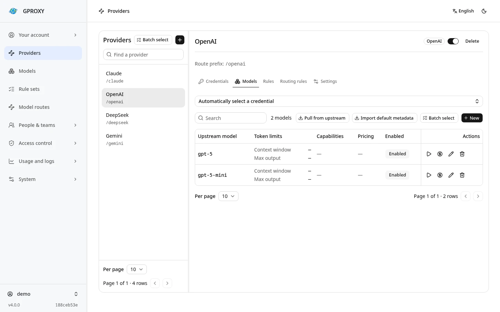
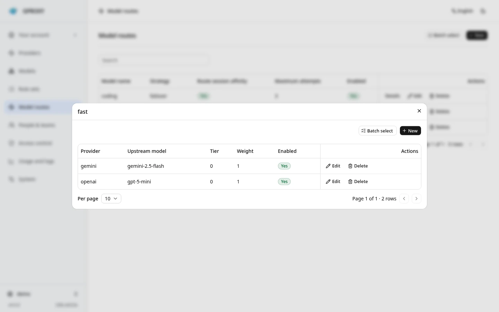

# GPROXY

[English](README.md) · [简体中文](README.zh-CN.md) · [Русский](README.ru.md)

[](https://github.com/LeenHawk/gproxy/releases/latest)
[](https://github.com/LeenHawk/gproxy/actions/workflows/ci.yml)
[](LICENSE)
[](https://app.fossa.com/projects/custom%2B37316%2Fgithub.com%2FLeenHawk%2Fgproxy?ref=badge_shield)

[Документация](https://gproxy.leenhawk.com/ru/) · [Загрузки](https://github.com/LeenHawk/gproxy/releases) · [Обсуждения](https://github.com/LeenHawk/gproxy/discussions) · [Поддержать](https://github.com/sponsors/LeenHawk)

<a href="https://deploy.workers.cloudflare.com/?url=https%3A%2F%2Fgithub.com%2FLeenHawk%2Fgproxy%2Ftree%2Fdev%2Fdeploy%2Fcloudflare-button"></a>
<a href="https://app.netlify.com/start/deploy?repository=https%3A%2F%2Fgithub.com%2FLeenHawk%2Fgproxy&branch=dev&create_from_path=deploy%2Fserverless"></a>
<a href="https://vercel.com/new/clone?repository-url=https%3A%2F%2Fgithub.com%2FLeenHawk%2Fgproxy%2Ftree%2Fdev%2Fdeploy%2Fserverless&project-name=gproxy&repository-name=gproxy&env=GPROXY_ADMIN_PASSWORD%2CGPROXY_MASTER_KEY&products=%5B%7B%22type%22%3A%22integration%22%2C%22group%22%3A%22postgres%22%2C%22protocol%22%3A%22storage%22%7D%5D"></a>
<a href="https://render.com/deploy?repo=https%3A%2F%2Fgithub.com%2FLeenHawk%2Fgproxy%2Ftree%2Fdev"></a>
<a href="https://heroku.com/deploy?template=https%3A%2F%2Fgithub.com%2FLeenHawk%2Fgproxy%2Ftree%2Fdev"></a>

GPROXY — шлюз для API языковых моделей, который вы размещаете у себя. Он
написан на Rust. Вы передаёте ему свои учётные записи у провайдеров: API-ключи,
OAuth-вход от подписок вроде Claude Code или Codex, cookie браузера. Те, кто
им пользуется, получают один базовый URL, один API-ключ GPROXY и имена моделей,
которые вы задаёте сами. Секреты провайдеров им недоступны.

Сам GPROXY модели не запускает: генерацию выполняет вышестоящий сервис.

Документация: **<https://gproxy.leenhawk.com/ru/>**



## Когда он пригодится

- У вас несколько подписок Claude или ChatGPT и набор API-ключей, и вы хотите
  поделиться ими с командой или друзьями. У каждого свой ключ со своими
  правами, ограничениями частоты и бюджетом, и потом видно, кто сколько
  израсходовал.
- Одна и та же модель доступна из нескольких источников, и они должны
  подстраховывать друг друга. Если учётная запись упёрлась в лимит или дала
  сбой, запрос уходит на следующую, а клиенту знать об этом не нужно.
- Клиент понимает только формат OpenAI, а провайдер — Claude или Gemini, или
  наоборот.
- Шлюз должен постоянно работать на сервере, NAS, в контейнере или на
  Cloudflare Workers.

Если нужно только переключать модели для Claude Code или Codex на своём
компьютере, проще взять настольный переключатель.
GPROXY не правит файлы настроек этих программ: адрес шлюза и ключ вы вводите
сами.

## Возможности

### Подписки в качестве источников

Кроме API-ключей, GPROXY может работать через учётные записи с подпиской:
Claude Code, веб-версия Claude, Codex (учётная запись ChatGPT), Gemini CLI,
Antigravity, GitHub Copilot CLI, Kiro, Grok Build, Kimi Code, Trae, Devin,
WorkBuddy и другие. Вы один раз входите в консоли, а дальше GPROXY сам
обновляет токены.

У одного провайдера может быть несколько учётных записей. Окна квот каждой
из них можно посмотреть, а запись, которой провайдер ограничил частоту,
уступает место остальным. Если включить привязку сеансов, один диалог идёт
через одну учётную запись, и кэш промптов не теряется из-за её смены.

Claude Code и Codex CLI отправляют не только запросы к моделям. Они ещё
запрашивают сведения об учётной записи, расход, плагины и прочее. GPROXY
отвечает и на эти запросы, поэтому официальные CLI работают, когда направлены
на шлюз. CLI показывает расход самого пользователя на шлюзе; сведения об общей
учётной записи ему не раскрываются.

### Несколько пользователей

Учётные записи делятся на пользователей, организации и команды, а
администратора можно ограничить одной организацией или командой. Для каждого
ключа можно задать разрешённых провайдеров и модели, ограничения частоты и
бюджет. Учётные данные могут принадлежать пользователю, организации или
команде, и другим они недоступны.

Программы, которые входят через OAuth, например Claude Code и Codex CLI, могут
входить прямо в ваш экземпляр GPROXY, так что раздавать ключ каждому не нужно.

Каждое обращение к провайдеру записывается с числом токенов и стоимостью.
Есть также журналы запросов и журнал аудита.

### Преобразование протоколов

Клиенты могут использовать OpenAI Chat Completions, OpenAI Responses, Claude
Messages или Gemini GenerateContent, с потоковой передачей или без неё. Если
форматы клиента и провайдера различаются, шлюз преобразует запрос и ответ.
Эмбеддинги, ранжирование, изображения, аудио, видео, файлы и Realtime доступны
там, где их предоставляет провайдер.

Преобразование меняет только формат запроса. Модель, которая не умеет
вызывать инструменты или читать изображения, не научится этому от того, что
её запросили в другом формате.

### Маршруты моделей

Клиент запрашивает имя вроде `fast` или `coding`, а вы решаете, какие
провайдеры и модели за ним стоят. Участников маршрута можно разделить на
уровни: следующий уровень используется, только когда на предыдущих ничего не
доступно. Внутри уровня запросы распределяются по кругу, по весам или в
заданном порядке. Можно обойтись и без маршрутов и запрашивать
`провайдер/модель` напрямую.



### Правила переписывания

Запросы и ответы можно переписывать для каждого провайдера: системные
подсказки, поля JSON, замены по регулярным выражениям, заголовки и точки
кэширования промптов. Некоторые клиенты не умеют задавать поля кэширования.
Для них в промпт можно вставить условленную строку, и если у провайдера
включён этот параметр, GPROXY заменит её точкой кэширования.

### Каналы

Помимо перечисленных выше подписок, встроены каналы для OpenAI,
Claude API, Google AI Studio, Vertex AI, AWS Bedrock, Azure, OpenRouter,
DeepSeek, GLM, Kimi, MiniMax, DashScope, Volcengine, xAI, NVIDIA NIM и другие;
полный список — в
[руководстве по провайдерам](https://gproxy.leenhawk.com/ru/guides/providers).
Совместимый сервис, который отличается только адресом и заголовками,
подключается через канал `custom`. Если сервису нужен собственный адаптер,
можно написать плагин канала вне этого репозитория, без форка; см.
[Добавление канала](https://gproxy.leenhawk.com/ru/development/adding-a-channel).

### Способы запуска

- Обычный сервер: CLI для Linux, macOS и Windows со встроенной веб-консолью
  или headless-сборка без консоли.
- Контейнер.
- Настольное и мобильное приложение со встроенной консолью и мастером
  настройки.
- Cloudflare Worker или функция Netlify / Vercel с тем же набором каналов, что
  и в обычной сборке.
- Библиотека для Rust: шлюз встраивается в вашу программу через `gproxy-sdk`.

База данных — SQLite, PostgreSQL или MySQL, а на Cloudflare — D1 или
libSQL/Turso.

## Установка

Linux и macOS:

```sh
curl -fsSL https://gproxy.leenhawk.com/install.sh | sh
```

Windows (PowerShell):

```powershell
irm https://gproxy.leenhawk.com/install.ps1 | iex
```

Скрипт скачивает последнюю стабильную версию CLI, задаёт несколько вопросов
(каталог данных, порт, пароль администратора) и может зарегистрировать фоновую
службу. Параметры смотрите в `--help`; например, `--edition headless`
устанавливает сборку без веб-консоли.

Пакеты можно скачать и вручную со страницы
[Releases](https://github.com/LeenHawk/gproxy/releases/latest). В каждом выпуске
есть:

- `gproxy-*` — CLI со встроенной веб-консолью;
- `gproxy-headless-*` — CLI без консоли, для CI и небольших серверов;
- `gproxy-tauri-*` — настольное и мобильное приложение.

GPROXY Desktop, CLI и Headless есть в Microsoft Store
([Desktop](https://apps.microsoft.com/detail/9P2FJRB9RS4Z),
[CLI](https://apps.microsoft.com/detail/9NBMH3S5K0L9),
[Headless](https://apps.microsoft.com/detail/9ND7FQQMV566)), приложение для
Android — в [F-Droid](https://f-droid.org/packages/com.leenhawk.gproxy.desktop/).
Сборки для macOS не нотаризованы. Все платформы и требования к ним перечислены
на [странице загрузки](https://gproxy.leenhawk.com/ru/download).

Стабильные выпуски помечаются тегами `vX.Y.Z`; выпуски `staging` и `nightly`
соответствуют бета-каналу и каналу разработки.

## Начало работы

Запустите сервер, указав каталог данных:

```sh
./gproxy serve --data-dir ./data --port 8787
```

При первом запуске в терминале GPROXY задаст несколько вопросов настройки. Без
терминала он сам создаёт учётную запись администратора и печатает её пароль и
API-ключ шлюза; сохраните оба. По умолчанию сервер слушает 127.0.0.1, а база
SQLite лежит в `./data/gproxy.db`.

Задайте `GPROXY_MASTER_KEY` до того, как добавлять учётные данные провайдеров:
без него секреты хранятся в открытом виде. При переносе и обновлении держите
ключ и каталог данных вместе; см.
[Конфигурация](https://gproxy.leenhawk.com/ru/reference/configuration).

Затем откройте <http://127.0.0.1:8787/console/>:

1. В разделе **Провайдеры** добавьте провайдера (например, `openai-main` на
   канале `openai`) и его API-ключ, затем проверьте учётные данные.
2. В разделе **Маршруты моделей** создайте маршрут `fast` и добавьте в него
   этого провайдера с проверенной моделью.

Теперь любой клиент, совместимый с OpenAI, может обращаться к шлюзу с его
API-ключом:

```sh
export GPROXY_KEY='your-gproxy-api-key'
curl http://127.0.0.1:8787/v1/chat/completions \
  -H "Authorization: Bearer $GPROXY_KEY" \
  -H 'Content-Type: application/json' \
  -d '{"model":"fast","messages":[{"role":"user","content":"Привет"}]}'
```

Тот же маршрут отвечает и на запросы в форматах Claude (`/v1/messages`) и
Gemini (`/v1beta/models/fast:generateContent`). Пошагово всё это разобрано в
[быстром старте](https://gproxy.leenhawk.com/ru/getting-started/quick-start), а
подключение Codex CLI и Claude Code описано в разделе
[CLI-клиенты](https://gproxy.leenhawk.com/ru/guides/cli-clients).

В настольном и мобильном приложении те же шаги выполняет мастер настройки, а
консоль встроена в само приложение.

## Размещение на платформах

Кнопки развёртывания в начале страницы используют описанные здесь шаблоны. Шаблоны для
Cloudflare, Netlify и Vercel разворачивают готовую сборку последней
стабильной версии, ничего не компилируя. Cloudflare использует D1 или
libSQL/Turso, две другие платформы — PostgreSQL. Render и Heroku запускают
обычный исполняемый файл в небольшом контейнере, тоже с PostgreSQL.

При развёртывании понадобятся пароль администратора и мастер-ключ. Сначала
прочитайте [Размещение на платформах](https://gproxy.leenhawk.com/ru/deployment/edge)
и [Docker, Render и Heroku](https://gproxy.leenhawk.com/ru/deployment/containers):
там описаны выбор базы данных, стоимость тарифов и ограничения каждой
платформы (например, на Netlify нет WebSocket).

## Обновление с v3

Остановите v3 и сделайте резервную копию базы данных, мастер-ключа и
конфигурации запуска. Затем запустите v4 с той же конфигурацией. Базы SQLite,
PostgreSQL, MySQL и D1 переносятся при первом запуске; учётные записи, пароли,
API-ключи и история использования сохраняются, а всё, что не удалось
перенести, попадает в отчёт о миграции. Не подключайте v3 и v4 к одной базе
одновременно. Подробности — в разделе
[Переход с v3 на v4](https://gproxy.leenhawk.com/ru/deployment/v3-to-v4).

## Производительность

Замеры сделаны на [выпуске v4.0.0 для Linux
x86_64](https://github.com/LeenHawk/gproxy/releases/tag/v4.0.0), процессор
Ryzen 7 8745H (8 ядер, 16 потоков), SQLite на NVMe; генератор нагрузки
(`oha 1.16.0`), шлюз и имитация провайдера работали на одной машине. Запросы —
непотоковые Chat Completions с полной обработкой: аутентификация,
маршрутизация, извлечение статистики, расчёт стоимости и запись в базу.
Имитация возвращала 25 входных и 18 выходных токенов без задержки. Запись тел
запросов была выключена, учёт использования и расчёт стоимости — включены.
Каждое значение — медиана трёх 10-секундных прогонов после 2-секундного
прогрева.

| Журнал запросов | Соединения | Запросов/с | p50 | p99 |
| --- | ---: | ---: | ---: | ---: |
| Выключен | 1 | 2 882 | 0,34 мс | 0,50 мс |
| Выключен | 32 | 28 303 | 0,76 мс | 2,71 мс |
| Выключен | 64 | 27 263 | 1,47 мс | 41,91 мс |
| Метаданные входящих и исходящих запросов | 64 | 7 765 | 2,81 мс | 45,16 мс |

На одном соединении шлюз добавляет к медианной задержке около 0,30 мс по
сравнению с прямым обращением к имитации. Все 1 989 395 запросов вернули 200, а
число записанных строк статистики совпало с числом запросов, с верными токенами
и стоимостью. Примерно на 64 соединениях пропускная способность перестаёт
расти, а p99 поднимается до 42 мс. Эти цифры относятся к коротким ответам,
пересылке без смены протокола и локальной SQLite; для длинных потоков,
преобразования протоколов, удалённой базы или настоящих провайдеров проведите
собственные замеры.

## Сборка из исходного кода

Нужны стабильный Rust, Go и Clang, а для консоли — Node.js 22.12 или новее и
pnpm. Консоль собирается до исполняемого файла, иначе ему нечего будет отдавать:

```sh
pnpm --dir console install --frozen-lockfile
pnpm --dir console build
cargo run -p gproxy -- serve
```

Сборка без консоли, настольного приложения и пакета для Workers, а также
проверки, которые выполняет CI, описаны в разделе [Сборка из исходного
кода](https://gproxy.leenhawk.com/ru/development/building). Участникам стоит
прочитать [CONTRIBUTING.md](CONTRIBUTING.md) и
[Архитектуру](https://gproxy.leenhawk.com/ru/development/architecture); о
подключении нового провайдера — [Добавление
канала](https://gproxy.leenhawk.com/ru/development/adding-a-channel).

## Сообщения об ошибках

Ошибки сообщайте в [Issues](https://github.com/LeenHawk/gproxy/issues), вопросы
задавайте в [Discussions](https://github.com/LeenHawk/gproxy/discussions). То,
что не хочется публиковать, можно отправить на
[leenhawk@leenhawk.com](mailto:leenhawk@leenhawk.com). Об уязвимостях сообщайте
закрыто, как описано в [SECURITY.md](SECURITY.md).

## Лицензия

GPROXY распространяется по лицензии GNU Affero General Public License версии 3
или более поздней; см. [LICENSE](LICENSE). Библиотечные крейты
`gproxy-protocol`, `gproxy-protocol-macros`, `gproxy-client`,
`gproxy-client-sdk`, `gproxy-cache`, `gproxy-file`, `gproxy-seaorm`,
`gproxy-store` и `gproxy-tokenizer` распространяются по лицензии MIT, у
каждого свой файл лицензии.

## Инструменты разработки

[](https://jb.gg/OpenSource)

[](https://www.netlify.com)

## История звёзд

[](https://www.star-history.com/#LeenHawk/gproxy&Date)
