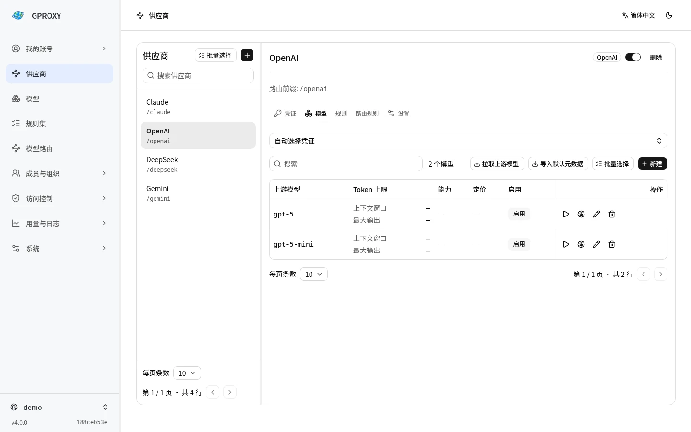

# GPROXY

[English](README.md) · [简体中文](README.zh-CN.md) · [Русский](README.ru.md)

[](https://github.com/LeenHawk/gproxy/releases/latest)
[](https://github.com/LeenHawk/gproxy/actions/workflows/ci.yml)
[](LICENSE)
[](https://app.fossa.com/projects/custom%2B37316%2Fgithub.com%2FLeenHawk%2Fgproxy?ref=badge_shield)

[文档](https://gproxy.leenhawk.com/zh-cn/) · [下载](https://github.com/LeenHawk/gproxy/releases) · [讨论](https://github.com/LeenHawk/gproxy/discussions) · [赞助](https://github.com/sponsors/LeenHawk)

<a href="https://deploy.workers.cloudflare.com/?url=https%3A%2F%2Fgithub.com%2FLeenHawk%2Fgproxy%2Ftree%2Fdev%2Fdeploy%2Fcloudflare-button"></a>
<a href="https://app.netlify.com/start/deploy?repository=https%3A%2F%2Fgithub.com%2FLeenHawk%2Fgproxy&branch=dev&create_from_path=deploy%2Fserverless"></a>
<a href="https://vercel.com/new/clone?repository-url=https%3A%2F%2Fgithub.com%2FLeenHawk%2Fgproxy%2Ftree%2Fdev%2Fdeploy%2Fserverless&project-name=gproxy&repository-name=gproxy&env=GPROXY_ADMIN_PASSWORD%2CGPROXY_MASTER_KEY&products=%5B%7B%22type%22%3A%22integration%22%2C%22group%22%3A%22postgres%22%2C%22protocol%22%3A%22storage%22%7D%5D"></a>
<a href="https://render.com/deploy?repo=https%3A%2F%2Fgithub.com%2FLeenHawk%2Fgproxy%2Ftree%2Fdev"></a>
<a href="https://heroku.com/deploy?template=https%3A%2F%2Fgithub.com%2FLeenHawk%2Fgproxy%2Ftree%2Fdev"></a>

GPROXY 是一个用 Rust 编写、自行部署的大模型 API 网关。上游账户（API Key、Codex 或 Claude Code 这类 OAuth 登录、浏览器 Cookie）统一交给 GPROXY 保管，客户端只需要一个网关地址、一个 GPROXY API Key，以及你自己定义的模型名。

每个请求进来后，GPROXY 先把模型名解析到具体的供应商，再挑一份可用的凭证；客户端和上游使用的协议不同时（OpenAI、Claude、Gemini 三种格式之间），由网关负责转换；最后记录 token 用量和费用。某个凭证或供应商出错时，会换下一个重试。用户、API Key、权限、限流和费用预算都可以在 Web 控制台或管理 API 中配置。

GPROXY 本身不运行模型，推理由上游服务完成。

完整文档：**<https://gproxy.leenhawk.com/zh-cn/>**



## 功能

- 对客户端提供 OpenAI Chat Completions、Responses、Claude Messages 和 Gemini GenerateContent 接口，支持流式，三种格式之间可以互相转换。嵌入、图像、音频、视频、文件和 Realtime 等接口，在上游提供时同样可用。
- 内置渠道包括 OpenAI、Claude API、Claude Code、Claude Web、Codex、Gemini CLI、Antigravity、Google AI Studio、Vertex AI、AWS Bedrock、Azure、GitHub Copilot CLI、OpenRouter、DeepSeek、智谱 GLM、Kimi、MiniMax、阿里云百炼（DashScope）、火山引擎、xAI、Kiro 等，完整列表见[供应商与凭证](https://gproxy.leenhawk.com/zh-cn/guides/providers)。其他兼容这三种协议的服务可以用 `custom` 渠道接入。
- 模型路由：客户端请求 `fast`、`coding` 这样的名字，由你决定背后用哪些供应商和上游模型，可以设置权重和回退层级。
- 凭证池：OAuth 自动刷新、健康状态跟踪、上游额度查询和故障切换。
- 按供应商配置的重写规则：系统提示词、提示缓存断点、JSON 字段、正则替换和请求头。
- 用户、组织、团队和分级管理员，按 Key 设置权限、限流和预算；用量统计、请求日志和审计日志。
- 可以作为原生服务、桌面或手机应用、容器运行，也可以部署为 Cloudflare Worker、Netlify 或 Vercel 函数。Rust 程序可以通过 `gproxy-sdk` 直接嵌入。

## 安装

Linux 和 macOS：

```sh
curl -fsSL https://gproxy.leenhawk.com/install.sh | sh
```

Windows（PowerShell）：

```powershell
irm https://gproxy.leenhawk.com/install.ps1 | iex
```

脚本会下载最新稳定版 CLI，询问数据目录、端口、管理员密码等几个问题，也可以顺便注册为后台服务。可用选项见 `--help`，例如 `--edition headless` 安装不带 Web 控制台的版本。中文环境默认从 CNB 镜像下载。

也可以从 [Releases](https://github.com/LeenHawk/gproxy/releases/latest) 手动下载。每个版本包含三类安装包：

- `gproxy-*`：内置 Web 控制台的 CLI；
- `gproxy-headless-*`：不含控制台的 CLI，适合 CI 和小型服务器；
- `gproxy-tauri-*`：桌面与移动应用。

Microsoft Store 上架了 GPROXY Desktop、CLI 和 Headless（[Desktop](https://apps.microsoft.com/detail/9P2FJRB9RS4Z)、[CLI](https://apps.microsoft.com/detail/9NBMH3S5K0L9)、[Headless](https://apps.microsoft.com/detail/9ND7FQQMV566)），Android 应用可以从 [F-Droid](https://f-droid.org/packages/com.leenhawk.gproxy.desktop/) 安装。macOS 版本没有经过公证。各平台的安装包和系统要求见[下载页](https://gproxy.leenhawk.com/zh-cn/download)。

稳定版的标签形如 `vX.Y.Z`；`staging` 和 `nightly` 两个 Release 分别对应测试版和开发版更新通道。

## 上手

指定数据目录启动服务：

```sh
./gproxy serve --data-dir ./data --port 8787
```

在终端里第一次运行时会先问几个设置问题。没有终端时，GPROXY 直接创建管理员账户，并打印管理员密码和一个网关 API Key，请把两者都保存好。默认只监听 127.0.0.1，SQLite 数据库位于 `./data/gproxy.db`。

添加任何上游凭证之前，先设置 `GPROXY_MASTER_KEY`；不设置的话，上游密钥会以明文保存。迁移或升级实例时，主密钥和数据目录要一起保留，详见[配置](https://gproxy.leenhawk.com/zh-cn/reference/configuration)。

然后打开 <http://127.0.0.1:8787/console/>：

1. 在**供应商**页面添加一个供应商（例如 `openai` 渠道的 `openai-main`）和它的 API Key，并测试凭证。
2. 在**模型路由**页面新建名为 `fast` 的路由，把刚才的供应商和测试通过的模型添加为成员。

之后任何兼容 OpenAI 的客户端都可以用网关 API Key 调用：

```sh
export GPROXY_KEY='your-gproxy-api-key'
curl http://127.0.0.1:8787/v1/chat/completions \
  -H "Authorization: Bearer $GPROXY_KEY" \
  -H 'Content-Type: application/json' \
  -d '{"model":"fast","messages":[{"role":"user","content":"你好"}]}'
```

同一个路由也可以用 Claude（`/v1/messages`）和 Gemini（`/v1beta/models/fast:generateContent`）格式请求。[快速开始](https://gproxy.leenhawk.com/zh-cn/getting-started/quick-start)一步步演示了上面的过程；Codex CLI 和 Claude Code 的接入方法见 [CLI 客户端](https://gproxy.leenhawk.com/zh-cn/guides/cli-clients)。

桌面和手机应用把这些步骤做成了设置向导，控制台也内置在应用里。

## 托管部署

页面顶部的部署按钮对应下面这些模板。Cloudflare、Netlify 和 Vercel 模板直接部署最新稳定版的预构建包，不需要编译。Cloudflare 使用 D1 或 libSQL/Turso，另外两个使用 PostgreSQL。Render 和 Heroku 则在一个小容器里运行原生程序，数据库同样是 PostgreSQL。

部署时需要填写管理员密码和主密钥。动手之前请先读[托管部署](https://gproxy.leenhawk.com/zh-cn/deployment/edge)和 [Docker、Render 与 Heroku](https://gproxy.leenhawk.com/zh-cn/deployment/containers)，里面讲了数据库怎么选、套餐费用，以及 Serverless 平台上有哪些功能用不了（比如 WebSocket）。

## 从 v3 升级

停止 v3，备份数据库、主密钥和启动配置，然后用同样的配置启动 v4。SQLite、PostgreSQL、MySQL 和 D1 数据库会在首次启动时自动迁移，账户、密码、API Key 和历史用量都会保留，无法映射的配置会列在迁移报告里。不要让 v3 和 v4 同时连接同一个数据库。详见[从 v3 迁移到 v4](https://gproxy.leenhawk.com/zh-cn/deployment/v3-to-v4)。

## 性能

测试使用 [v4.0.0 Linux x86_64 正式版](https://github.com/LeenHawk/gproxy/releases/tag/v4.0.0)，机器是 Ryzen 7 8745H（8 核 16 线程），SQLite 放在 NVMe 上；压测工具 `oha 1.16.0`、网关和模拟上游运行在同一台机器上。请求为非流式 Chat Completions，完整经过鉴权、路由、用量提取、计价和落库。模拟上游每次返回 25 个输入 token、18 个输出 token，不加延迟。测试时关闭了正文记录，用量记录和费用结算保持开启。每个数字取三轮测试的中位数，每轮先预热 2 秒，再测 10 秒。

| 请求日志 | 连接数 | 请求/秒 | p50 | p99 |
| --- | ---: | ---: | ---: | ---: |
| 关闭 | 1 | 2,882 | 0.34 ms | 0.50 ms |
| 关闭 | 32 | 28,303 | 0.76 ms | 2.71 ms |
| 关闭 | 64 | 27,263 | 1.47 ms | 41.91 ms |
| 记录上下游元数据 | 64 | 7,765 | 2.81 ms | 45.16 ms |

单连接时，经过网关比直接请求模拟上游的中位延迟多约 0.30 ms。全部 1,989,395 个请求都返回 200，落库的用量行数与请求数一致，token 和费用也都核对无误。连接数到 64 左右吞吐不再增长，p99 升到约 42 ms。以上结果只针对短响应、同协议转发和本地 SQLite；如果你的场景有长流式响应、协议转换、远程数据库或真实上游，请自己实测。

## 从源码构建

需要 stable Rust、Go 和 Clang；构建控制台还需要 Node.js 22.12 或更高版本以及 pnpm。必须先构建控制台再构建程序，否则程序里没有控制台可用：

```sh
pnpm --dir console install --frozen-lockfile
pnpm --dir console build
cargo run -p gproxy -- serve
```

Headless 版本、桌面应用、Workers 包的构建方法，以及 CI 跑的检查，见[从源码构建](https://gproxy.leenhawk.com/zh-cn/development/building)。参与开发请先读 [CONTRIBUTING.md](CONTRIBUTING.md) 和[架构](https://gproxy.leenhawk.com/zh-cn/development/architecture)；要接入新的上游，见[添加渠道](https://gproxy.leenhawk.com/zh-cn/development/adding-a-channel)。

## 反馈问题

Bug 请提交到 [Issues](https://github.com/LeenHawk/gproxy/issues)，使用问题可以在 [Discussions](https://github.com/LeenHawk/gproxy/discussions) 讨论。不方便公开的内容可以发邮件到 [leenhawk@leenhawk.com](mailto:leenhawk@leenhawk.com)。安全漏洞请按 [SECURITY.md](SECURITY.md) 私下报告。

## 许可证

GPROXY 以 GNU Affero 通用公共许可证第 3 版或更新版本（AGPL-3.0-or-later）发布，见 [LICENSE](LICENSE)。其中的库 crate `gproxy-protocol`、`gproxy-protocol-macros`、`gproxy-client`、`gproxy-client-sdk`、`gproxy-cache`、`gproxy-file`、`gproxy-seaorm`、`gproxy-store` 和 `gproxy-tokenizer` 采用 MIT 许可证，各自目录下有许可证文件。

## 工具支持

[](https://jb.gg/OpenSource)

## Star History

[](https://www.star-history.com/#LeenHawk/gproxy&Date)
